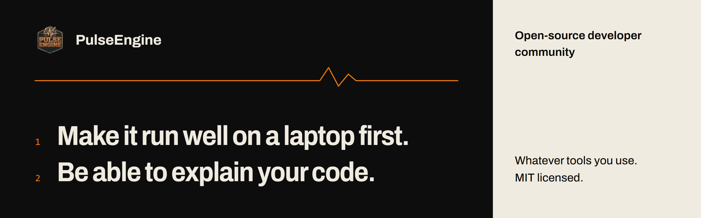

  

  
  
  
  
  

PulseEngine is an open-source developer community. Students, hobbyists and working engineers build MIT-licensed software together, in public. We build around two ideas.

### 1. Make it run well on a laptop first

An ordinary laptop is the starting point. Code that runs well there is lean code, and the cloud can then scale it further instead of making up for it.

### 2. Be able to explain your code

Use any editor, any AI assistant, any tool you like. A good developer can walk others through how their code works, and we help each other get there. Every pull request comes with a short explanation in plain words.

## Projects

<!-- projects:start -->
| Project | What it does | Language | Stars | Last commit | Status |
|---|---|---|---|---|---|
| [**API-Cupboard**](https://github.com/The-Pulse-Engine/API-Cupboard) | A local API cupboard for your laptop. Store all API keys once in the OS keychain and use them in any project through env injection or a localhost proxy. No .env files. Go, single binary, Windows and Linux. | Go |  |  |  |

1 public project. This table rebuilds itself every day from the organisation's public repositories.
<!-- projects:end -->

## How we work

- All work happens in public. Commits, issues and design discussions are open from the first line of code.
- The software collects no data. There is no telemetry and no account to create.
- Everything is MIT licensed. Anyone can read, fork, change and share the code.
- We share progress openly, slow weeks included. When an approach does not work, we write up what we learned.

## Get involved

1. Clone a repository and run it on your own machine. If the setup steps are unclear, that is a documentation bug worth filing.
2. Take an open issue. A first pull request can be small and still be worth merging.
3. Explain your change in the pull request: what you changed and why. Bigger questions get discussed in Discord.

Anyone can contribute, from first-year students to working engineers. A clear bug report or a fixed typo is a real contribution.

## Say hello

Day-to-day talk happens on [Discord](https://discord.gg/VU8RUByEeG). Weekly recaps go out on [LinkedIn](https://www.linkedin.com/company/the-pulse-engine/). For sponsorship, hiring or press, use the [contact section on our website](https://the-pulse-engine-website.bhargavaramkrishnapur.workers.dev/#contact).

  Built to run on your laptop. Written to be explained.

